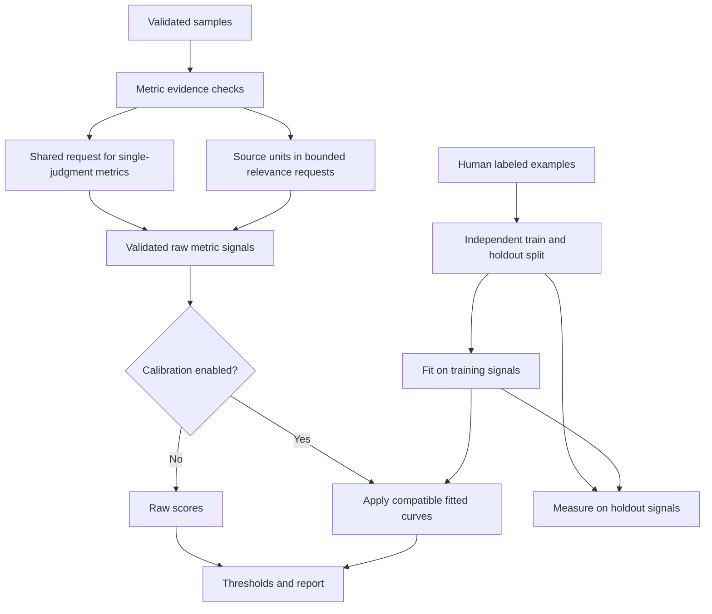

# Architecture and extension contract

The convenience entry points are `evaluate` and `aevaluate`. `Evaluator` owns a
metric panel and backend; `EvaluationPipeline` adds optional calibration using a
`CalibrationBundle`.

Three adapters are bundled: `JevBackend` (default), `OpenAIDecisionsBackend`
(optional `openai` extra), and `SystemOneBackend` for deployed Jev-compatible
servers, including Clef, Laya, and Strands Decider. `JevBackend` also supports
TypeSafe-compatible hosted endpoints, such as Microsoft Decision-1 on OpenRouter.
All three extend the public `BaseBackend` API. Custom adapters can extend the same
base; existing implementations of the `Backend` protocol remain supported.
Evaluation and runtime guards remain provider independent.



## Modules

| Module | Responsibility |
|---|---|
| `data/models.py` | Validated samples and image inputs, observed tool calls, labels, metric/sample results, summaries |
| `data/datasets.py` | Validated JSON and JSONL interchange |
| `metrics/base.py` | Custom metric model, validation, signal extraction, and reload handling |
| `metrics/rag.py`, `metrics/agents.py` | Built-in response, RAG, agent, and policy rubrics |
| `metrics/context_units.py` | Versioned deterministic source segmentation with exact passage and character-span provenance |
| `metrics/registry.py`, `metrics/presets.py` | CLI metric registry and fixed evaluation panels |
| `backends/base.py` | Shared `BaseBackend`, backend/session protocols, and judgment contracts |
| `backends/capabilities.py`, `backends/provenance.py` | Optional modality preflight and static calibration identity |
| `backends/jev.py` | Official TypeSafe SDK adapter, including optional image transport |
| `backends/openai_decisions.py` | Native Decisions compilation, strict answer validation, and flat usage conversion |
| `backends/systemone.py` | HTTP adapter for deployed System One servers, optional authentication, retries, and flat usage conversion |
| `evaluation/evaluator.py` | Preflight, fixed worker pool, per-sample batching, error policy, aggregation |
| `evaluation/pipeline.py` | Opt-in lifecycle, independent split, fitting, save/load, automated run |
| `evaluation/validation.py` | Independent labeled evaluation, coverage, decision errors, and tie-aware ROC-AUC |
| `evaluation/decorators.py` | Sync/async decorators preserving native outputs |
| `calibration/core.py` | Venn–Abers/isotonic fitting, portable prediction, diagnostics, validated artifacts |
| `runtime/guards.py` | Named execution checkpoints, decision policies, tool dispatch gates, response metadata |
| `runtime/agents.py` | Framework-independent agent decorators, entrypoint discovery, and instance proxies |
| `runtime/tools.py` | Shared tool-argument snapshots, evidence mapping, and guarded execution |
| `adapters/` | LangChain, CrewAI, and Microsoft Agent Framework tool registration and runtime mapping |
| `cli.py` | Dataset evaluation, calibration fitting, and CI gate exit codes |

These paths are relative to `typed_evals/`. Each subpackage exposes its public
objects through `__init__.py`; the root package continues to export the existing
public API. For example, `typed_evals.metrics.Metric` and
`typed_evals.evaluation.Evaluator` are available alongside their root imports.
See the [changelog](../CHANGELOG.md) for direct implementation import migrations.

Importing the core package or an adapter module does not import an agent framework.
It does not import OpenAI either; the optional SDK loads when Decisions is used.
The CrewAI decorator loads CrewAI when creating a native tool. The LangChain and
Microsoft adapters operate on the runtime objects injected by their frameworks.
See the [adapter guide](ADAPTERS.md) for the integration contracts.

## Backend interface

Extend `BaseBackend` for a provider with a new request protocol. Import it from
`typed_evals` or `typed_evals.backends`; the shared `Backend`, `JudgeSession`,
`JudgeResponse`, and `Question` contracts live in `typed_evals.backends.base` and
are exported by `typed_evals.backends`. Existing imports of these contracts from
`typed_evals.backends.jev` remain supported.

The base declares `model: str` and an abstract `session()`, an asynchronous context
manager yielding a `JudgeSession`. The session implements:

```python
async def judge(
    self, state: dict[str, Any], questions: Mapping[str, Question]
) -> JudgeResponse: ...
```

`Question` is a TypeSafe SDK Noul, Choice, or Score object. `JudgeResponse`
requires the actual model ID and typed-answer dictionaries. Optional `usage`
contains scalar counters, with `None` for unknown values; `answer_errors` can
associate `"invalid_answer"` or `"refusal"` with individual question names while
preserving successful sibling answers.
`BaseBackend` provides text-only `supported_modalities`, shared image validation
through `validate_state(state)`, and common `__post_init__` validation for `model`,
`timeout`, and `max_retries` (defaulting to 30 seconds and 2 retries). A dataclass
subclass can declare its provider configuration and inherits that validation;
call `super().__post_init__()` if overriding the hook. A plain subclass can use
class attributes and call `__post_init__()` from its constructor when it needs
configuration validation. Its public static `image_inputs(state)` returns a
validated `tuple[ImageInput, ...]` from the ordered image evidence, or an empty
tuple when none is selected. All bundled image adapters share this parser.
Providers own client creation, requests, cleanup, and image transport.

`calibration_provenance(...)` remains an optional provider hook, so extending
`BaseBackend` does not change calibration behavior for a backend without it.
The structural `Backend` protocol continues to accept custom backends that supply
`model` and `session()` without inheritance.

The core `typesafe-sdk` dependency is required for metric construction even when
the chosen backend uses another provider. Pass a custom backend as `backend=` to
evaluation entry points or runtime guards. The runnable `SyntheticBackend` in
[`examples/offline_demo.py`](../examples/offline_demo.py) extends `BaseBackend`,
yields itself as a session, and implements `judge` without making API requests.

TypeSafe-compatible hosted models use `JevBackend` directly with `model`,
`base_url`, and `api_key`. For Microsoft Decision-1 on OpenRouter, set
`model="microsoft/microsoft-decision-1"` and
`base_url="https://openrouter.ai/api"` with an OpenRouter API key and
`image_mode="disabled"`, because that model does not support image evidence.
The TypeSafe SDK appends `/v1/systemone` and handles the existing typed question/answer
protocol, so this configuration reuses `JevBackend`. A model served over a
different protocol needs a new `BaseBackend` subclass. See the
[hosted-model guide](EVALUATION.md#hosted-typesafe-compatible-models) and
[OpenRouter example](../examples/openrouter_decisions.py).

`SystemOneBackend(model=..., base_url=..., api_key=None)` sends the same typed
question schemas to `/v1/systemone` through an async HTTP client. The required
`base_url` is an API root; path prefixes are preserved before `/v1/systemone` is
appended. Credentials are explicit, so a keyless server needs no TypeSafe API key
or environment configuration. The adapter retains the server's model and typed
answers, and ignores non-counter usage metadata. See the
[open-model guide](EVALUATION.md#open-and-self-hosted-system-one-models) and
[runnable example](../examples/systemone_decisions.py).

Image support is an optional backend capability. An image-capable subclass
overrides the base property:

```python
@property
def supported_modalities(self) -> frozenset[str]:
    return frozenset({"text", "image"})
```

`BaseBackend` defaults to text only. Backends without `supported_modalities` are
also treated as text-capable, preserving the existing protocol. Decisions
advertises text and image support; Jev does so when `image_mode` is
`"experimental"` or `"native"`, and System One when `image_mode="native"`.
Jev and System One both default to `"disabled"`. The evaluator checks selected modalities before
opening a session. Overriding `validate_state(state)` lets a backend preflight its
provider-specific limits across the whole batch before any requests; use the
base's image parser to retain common validation. Unselected
images do not affect text requests or require an image-capable backend.

Images live in the shared `EvaluationSample.images` field as validated
`ImageInput(data_url=..., detail=..., label=...)` objects. The selected evidence
state contains their ordered JSON-compatible representation. An image-capable
adapter translates that state into its own wire format and applies its own limits.
Jev validates PNG/JPEG and `detail="auto"`, then converts the images to SDK
`Image` objects. The SDK handles multipart assets and image references; the adapter
preserves order and labels. The Jev-specific `image_mode="experimental"` sends
the image feature header, while `"native"` uses the same transport without it. This explicit setting
supports graduation of the existing image API without a model-version allowlist
or capability discovery; changes to the wire API can still require adapter work.
System One native mode sends an ordered top-level `images` array of
`{"url": data_url, "detail": detail}` objects and leaves indexed label/detail
metadata in the JSON state. Image bytes appear only in that array. This requires
a vision-capable model and a server accepting the SGLang image extension; basic
System One compatibility alone does not establish image support. The adapter
accepts the shared PNG/JPEG/WebP/GIF formats and `auto`, `low`, or `high` detail;
`original` fails preflight. The server applies its byte, dimension, and processing
limits; the adapter does not resize or transform images. No TypeSafe experimental
header or SDK multipart asset format is used. See the
[System One image example](../examples/systemone_images.py).
Image evidence is selected through `Metric.required_fields`; text-only built-ins
do not implicitly consume images. `ToolSafety` separately selects application-owned
`authorization` alongside tool specifications in `contexts`.

`JevBackend(client=existing_async_client)` and
`OpenAIDecisionsBackend(client=existing_async_openai_client)` allow custom
transports, endpoints, or caller-owned SDK configuration. The caller closes that
client. Its timeout and retry settings supersede the backend's `timeout` /
`max_retries`; each adapter still passes its explicit `model` on every request.
`SystemOneBackend(client=existing_async_http_client, model=..., base_url=...)`
also leaves its injected client open; its adapter owns request retries and uses
the supplied client's timeout configuration.
Use a supplied async client inside its owning event loop. Jev remains the default;
Decisions defaults to `gpt-6-luna` and requires `typed-evals[openai]`.

Without an injected client, each evaluation batch creates and closes a pooled
client, including on exceptions or cancellation. Sync entry points use
`asyncio.run`. When the calling thread already has a running event loop (for
example, in a notebook), they use a worker thread with a separate loop and a copy
of the caller's context variables. The worker and its loop are closed after each
call, including when evaluation raises. These calls still block the caller;
await the async APIs to keep notebook/server event loops responsive. Supplied
async clients and custom backends with resources tied to a loop must use the
async APIs in their owning loop.

### OpenAI Decisions API translation

Decisions API uses the official OpenAI Python SDK `>=3.26.0,<4` and its dedicated
`await client.decisions.create(...)` endpoint, `POST /v1/decisions`. The adapter
uses the SDK's `with_raw_response.create(...)` wrapper to validate original JSON
before SDK model coercion, retaining the same transport and retries. It
serializes only the supplied evidence state deterministically, preserving Unicode,
structured tool evidence, and complete instructions without truncation. It compiles
the questions supplied for each request with unique names. Single-judgment
metrics share a request; context relevance has separate bounded unit requests:

| Metric primitive | Decisions question | Raw metric signal |
|---|---|---|
| Noul | Predicate; policy and true/false descriptions are included in instructions | Probability of the positive condition |
| Choice | Original string keys and descriptions in deterministic choice order, 2–255 choices | Sum of probabilities of `pass_options` |
| Score | Declared level order, stable stringified ordinal labels, original descriptions | Expected ordinal divided once by `number_of_levels - 1` |

The backend returns the expected ordinal Score unchanged to the existing metric
parser, which performs the sole normalization. Duplicate descriptions retain
distinct ordinal labels. Strings such as `"true"` and `"false"` remain strings.
Response association uses question names; duplicate, unexpected, or untrustworthy
associations fail the request. Independently attributable answer errors and
refusals can be recorded per metric. Distributions are validated before conversion
to dictionaries, so duplicates and malformed wire values cannot disappear through
coercion. Nested SDK usage is flattened into scalar counters. The response's actual
model ID is retained.

Context relevance compiles one Noul question per source unit. The evaluator
counts the units whose positive probability meets `unit_threshold`, then returns
their fraction with `raw_kind="relevance_fraction"`. Backend translation does
not turn that fraction into an acceptance probability. An optional calibration
curve performs that separate mapping to binary human acceptance.
`unit_threshold` applies to each unit's probability; the metric's final
`threshold` applies to the aggregate fraction, or its calibrated probability when
available. Calibration does not change unit verdicts or their retained counts.

For image-selected state, Decisions builds one user message containing an
`input_text` part for the JSON evidence followed by ordered `input_image` parts.
The text identifies image positions and optional labels; base64 image data appears
only in the native image parts. Image detail is preserved. The shared schema
accepts inline PNG, JPEG, WebP, and GIF data URLs; Decisions validates its limit of
128 selected images. Text-only state retains its existing request format.

Calibration provenance is an optional backend capability, separate from the
`Backend` protocol. Bundled adapters identify their provider, backend, compiler
version, and ordered static question templates; Jev, Decisions, and System One
also record the effective endpoint (without URL userinfo, query, or fragment). The
pipeline fingerprints that configuration without sample evidence, final decision
thresholds, credentials, or transport settings. Caller-owned clients with additional custom routing
behavior must keep that behavior stable for a fitted curve. A third-party backend
implementing only `model` and `session()` remains
usable and produces an explicit unknown-provenance v3 artifact. See
[version compatibility](CALIBRATION.md#artifact-versions-and-compatibility).

Selecting images uses multimodal compiler provenance and state-schema marker 3
in the metric fingerprint. Selecting authorization uses marker 4, including for
metrics that also select images.
The revised evaluation policy and built-in rubrics invalidate older metric
fingerprints and require refitting. Jev image provenance includes its image compiler and `image_mode`;
changing the mode or model requires a refit. Sample overlap hashes include selected
image content, order, detail, and labels, while provenance and saved reports contain
no raw image bytes.

Context-relevance metric identity binds the aggregation protocol, deterministic
segmentation version, granularity, unit threshold, and questions per call. Its
source units and target indices vary with each sample; static configuration
fingerprints contain no source text. Each batch snapshots the question template
once and derives unit-specific questions from it using that versioned recipe.
Refit existing panels containing the former
whole-context metric. Unrelated single-judgment metric identities are preserved
by this aggregation change.

## Calibration and independent validation

`MetricResult.raw_kind` distinguishes `event_probability`,
`normalized_ordinal_score`, and `relevance_fraction`. Optional calibration maps
the raw signal to the binary metric-pass label supplied by the caller; `score`
uses that calibrated probability when available. Raw ordinal scores and fractions
remain numeric signals, even when Brier, ECE, or log loss is calculated for them
as probability proxies. Reports preserve the raw kind rather than relabeling
these signals as acceptance probabilities.

Fitting diagnostics use only labeled hold-out rows after curves are fitted on
training labels. `raw.at_threshold` and `calibrated.at_threshold` record confusion
counts and decision rates at the configured final threshold. The fit report's
`constant_prior_brier` evaluates the training positive rate on those hold-out
labels. It does not use hold-out prevalence to construct the predictor. Changing
only a final threshold preserves the curve but requires independent validation
of the new decision policy.

`validate_metrics` and `avalidate_metrics` evaluate separate caller-labeled data
without fitting or tuning. They preserve the configured panel even when labels
are sparse. Coverage is successful labeled judgments divided by all labels for
that metric; skipped/error judgments are excluded from score diagnostics and
reduce coverage. Accuracy, tie-aware ROC-AUC, and the descriptive
`majority_baseline_accuracy` use the same evaluated subset. That majority baseline
is distinct from the fit report's training-prior baseline. ROC-AUC is `None` for
single-class subsets; absent labels or judgments leave the corresponding
diagnostics unavailable. Reserved calibration content/group overlap checks
still apply when a calibration bundle is supplied.

## Behavior under failures

- All sample input checks occur before the first request in an evaluation batch.
- A missing required evidence field raises by default. Explicit skips have no score.
- Supplied contexts excluded by all active metrics produce one warning per batch,
  after input validation and before the backend session opens.
- Jev and Decisions use their SDK retries; System One retries transient HTTP and
  transport failures. Permanent bad requests and authentication errors are not retried.
- API failures raise by default. `errors="record"` records the exception type
  without copying provider response bodies into exported reports.
- Decisions SDK transport failures become `OpenAIDecisionsError` after SDK
  retries, with a safe type-only message and suppressed provider exception chain.
  A per-question refusal uses `DecisionRefusalError`, a subclass of
  `InvalidAnswerError`; refusal contents are withheld.
- System One transport failures become `SystemOneError` with only the HTTP
  status or transport exception type. Invalid or missing answers are unavailable
  per metric; unknown answer names and duplicate JSON fields fail the request.
- Jev partial response omissions are validated metric by metric. Decisions
  missing, duplicate, or unexpected question names fail the entire request;
  attributable malformed answers and refusals are handled per metric. Unavailable
  answers never become zero, an empty success, or a synthetic confidence value.
- Decisions refusals are unavailable judgments. Recording one preserves successful
  sibling metrics and leaves the sample's overall pass status unavailable.
- Any unavailable context unit makes the whole relevance aggregate unavailable.
  In record-errors mode, all source-unit addresses and successful verdicts remain
  visible; failed units stay in the total and unavailable counts. There is no
  silent reduction of the denominator. Explicit empty retrieval scores zero
  without a unit request; omitted contexts are missing evidence, and blank source
  passages fail sample validation. Without any other judge request, the sample
  has `model=None` and empty usage. A compatible curve can still map its raw zero
  to a nonzero calibrated acceptance probability.
- Fitting requires one observed model version across actual judge responses.
  Deterministic empty-retrieval rows may have no model, but an entirely
  request-free fit is rejected. Model changes across a sample's unit requests
  make its relevance aggregate unavailable; a calibrated model mismatch is fatal.
- If a worker raises, the remaining workers are cancelled and awaited before
  closing the client. Already-sent requests may still have been billed.
- Calibration mismatch is always fatal, including in record-errors mode.
- Fitting and calibrated evaluation require the complete configured panel's
  evidence on every row. Sparse labels do not allow sparse evidence; skips cannot
  change the active questions while a fitted curve is being used.
- A failed refit leaves the last successfully fitted calibration bundle intact.

## Performance and intentional boundaries

Single-judgment question templates are constructed once per batch. Their questions
share one request and state per sample. Context relevance deterministically
segments each source passage into exact sentence/line spans (or whole passages),
then constructs target-specific questions in chunks of `questions_per_call`
(default 32, maximum 128). There is no generated statement extraction, content
truncation, or hidden unit cap. Sentence boundaries are heuristic rather than
atomic factual claims; passage granularity is an explicit coarser alternative.

One shared connection pool and at most `max_concurrency` sample workers bound
in-flight requests. Each worker processes its sample's requests sequentially;
there is no task per unit and no separate unit concurrency multiplier. Sample
usage combines the requests made for its panel. The materialized report uses
O(number of samples × number of metrics + total context units) memory, retaining
every unit verdict and span. Unknown or missing counters from any contributing
response remain unknown in summed sample usage. Process very large datasets in
batches with `evaluate`, reusing the saved calibration bundle.

Question chunking does not bound request tokens. Every chunk carries the complete
source passages for its target units, so a long passage spanning several chunks
is sent repeatedly. Provider context limits and input-token costs still apply;
there is no automatic source truncation.

Single-judgment requests include only the union of fields required by their
active metrics. Each question declares `allowed_evidence_fields`; this is
rubric-level guidance within that shared state. Context-relevance requests
physically exclude the generated response and reference answer. They contain the
query, a chunk of exact source units, and their original passages only for
disambiguation of the target unit. Relevance does not verify factual truth, and
other useful source content cannot make an unrelated target unit relevant.
`authorization` is an application-owned permission field;
retrieved passages and user claims in `contexts` cannot grant access.
Unrelated metadata and labels are excluded. Raw evidence is supplied to the
selected provider for evaluation; it is not redacted automatically. No execution logs, cache files,
or raw response text are persisted by default. Context-unit reports retain
passage/unit indices, character offsets, probabilities, decisions, counts, and
error types without raw source text. Saved calibration artifacts contain
knots, metrics, model IDs, diagnostics, and hashes, not raw training text.

The metric registry supports Noul, Choice, and Score through all three bundled backends.
It does not generate claims,
explanations, or chain-of-thought with another LLM. It does not reimplement framework
callbacks or orchestrate an agent. `RuntimeGuard` can invoke an explicitly supplied
operation/tool once after its checkpoint permits it, and gate materialized output
before delivery. It never automatically retries application actions. Proposals
are separate from observed tool events. See the [runtime contract](RUNTIME.md)
for policy, failure, concurrency, and framework-adapter semantics.
Runtime audit data uses `metadata["typed_evals"]`; the legacy `metadata["jev"]`
alias remains available with the same payload for existing consumers.
It does not claim numeric equality with existing
Ragas/DeepEval metrics. Integrate native outputs through explicit sample mappings.
